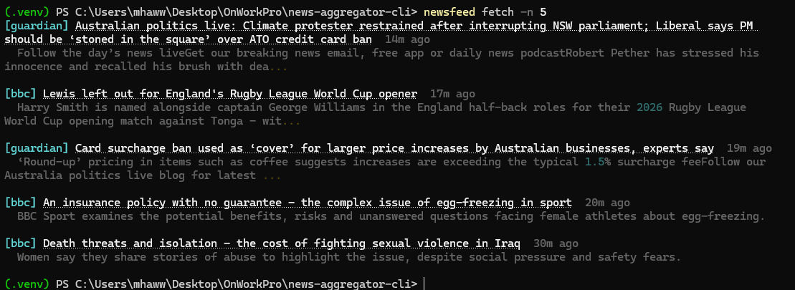

# newsfeed

 

A command-line news reader that pulls headlines from several RSS feeds into one clean terminal feed. No API keys needed.



## Why this exists

Checking many news sites for the same topic takes time. `newsfeed` fetches BBC, NYT, The Guardian and Hacker News in one go, removes duplicates, and shows you a single list you can filter by topic.

It was built as a first finished project in a larger build plan, to practise RSS/API handling, caching, testing and packaging.

## Features

- Multiple sources: BBC, NYT, The Guardian, Hacker News
- Duplicate removal (same URL or same title)
- 15-minute on-disk cache
- Topic filter that matches whole words, case-insensitive
- Clean Rich terminal output with clickable titles
- No API keys

## Install

Requires Python 3.9 or newer.

**(a) Directly from GitHub:**

```
pip install git+https://github.com/MooreHaww/news-aggregator-cli.git
```

**(b) From a clone, Windows (PowerShell):**

```
git clone https://github.com/MooreHaww/news-aggregator-cli.git
cd news-aggregator-cli
python -m venv .venv
.venv\Scripts\Activate.ps1
pip install .
```

**(b) From a clone, Mac/Linux:**

```
git clone https://github.com/MooreHaww/news-aggregator-cli.git
cd news-aggregator-cli
python3 -m venv .venv
source .venv/bin/activate
pip install .
```

Check it worked: `newsfeed --version`

## Usage

Newest headlines come first. Each item shows the source in brackets, a clickable title, how long ago it was published, and a short summary. Hacker News items show points and comments instead, e.g. `296 points · 240 comments`.

| Command / flag | What it does | Example |
| --- | --- | --- |
| `newsfeed fetch` | Fetch all sources and print the latest 20 headlines. | `newsfeed fetch` |
| `-t`, `--topic TEXT` | Keep only items whose title or summary contains this whole word. Repeat to match any of several. | `newsfeed fetch -t climate -t energy` |
| `-s`, `--source NAME` | Use only this source: `bbc`, `nyt`, `guardian`, `hn`. Repeat for several. An unknown name prints an error and exits with code 2. | `newsfeed fetch -s bbc -s hn` |
| `-n`, `--limit N` | Maximum number of items to show (default 20). | `newsfeed fetch -n 5` |
| `--refresh` | Ignore the cache and download the feeds again. | `newsfeed fetch --refresh` |
| `newsfeed sources` | List the available source names and feed URLs. | `newsfeed sources` |
| `--version` | Print the installed version, e.g. `0.1.0`. | `newsfeed --version` |

Flags combine: `newsfeed fetch -s guardian -t ai -n 10 --refresh`.

If nothing matches, it prints `No articles found.` If a feed can't be reached, a warning is shown and the other sources still print.

## Is it a library?

No. It is a command-line tool meant to be run, not imported. Internally the code is split into small modules (`fetcher.py`, `dedupe.py`, `filters.py`, `cache.py`, `render.py`) under `src/newsfeed/`, so they can be reused in other scripts, but there is no stable public API.

## How it works

Each source's public RSS feed is downloaded with `requests` (in parallel) and parsed with `feedparser` into simple `Article` objects. Each feed is cached as JSON for 15 minutes. The articles are then merged, sorted newest first, de-duplicated by URL and title, filtered by topic, trimmed to the limit, and printed with Rich.

## Performance

A fresh fetch of all four feeds takes about 1.2 seconds. A cached fetch takes about 0.3 seconds, roughly 4x faster.

## Process

I planned the project in plan mode with Claude Code, then built it step by step, manually approving every edit. I tested it myself in a terminal.

Testing turned up two bugs:

- The topic filter matched "ai" inside words like "said".
- The Hacker News summaries showed raw text.

Both were fixed and are now covered by tests.

## What I learned

*(Draft, to be edited.)*

- I learned how RSS feeds work and how to parse them with `feedparser` instead of scraping web pages.
- I added a cache with a time limit so repeat runs are fast and I don't hit the feeds every time.
- Different sources often carry the same story, so I had to remove duplicates by URL and by title.
- Filtering by topic is harder than it looks: matching "ai" inside "said" showed me why whole-word matching matters.
- I tested against saved sample data so the tests run offline and give the same result every time.
- I packaged the project with `pyproject.toml` so it installs with `pip` and gives a `newsfeed` command.
- I pushed it to GitHub and wrote a README so other people can install and use it.

## Future improvements

- **Category filters:** filter by section (world, tech, business) instead of only by keyword.
- **Config file for custom sources:** add or remove feeds in a user config file instead of editing `sources.py`.
- **SQLite cache:** replace the JSON files with a SQLite database to keep history and make lookups easier.
- **`--since` flag:** show only articles published after a given time, e.g. `--since 2h`.

## Running the tests

```
pip install -e ".[dev]"
pytest
```

The tests run offline.

## Adding your own source

Sources are listed in `src/newsfeed/sources.py`. Add a name and an RSS/Atom URL:

```python
DEFAULT_SOURCES = {
    ...
    "verge": "https://www.theverge.com/rss/index.xml",
}
```

Then run `newsfeed sources` to see it, and `newsfeed fetch -s verge` to use it. (Reinstall with `pip install .` unless you installed with `-e`.)
